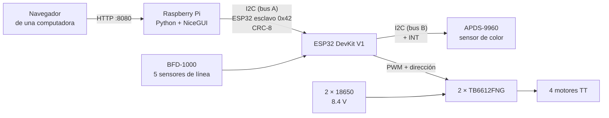

# ProyectoMicrocontrolador: carro con seguimiento de pista

Proyecto final de **MT-7003 Microprocesadores y Microcontroladores**
Escuela de Ingeniería Mecatrónica, Instituto Tecnológico de Costa Rica (TEC), II Semestre 2026
Profesor: Dr.-Ing. Carlos Adrián Salazar García

## Integrantes

- Arguedas Maroto Christopher Andrés
- Cascante Chinchilla Ignacio Alberto
- Miranda Granados Dylan Johel
- Rodríguez López Brayan Audiel
- Rodríguez Mora Bryam Samuel

## Descripción general

El proyecto consiste en un carro que sigue una pista marcada con tape negro de unos 2 cm de ancho, con curvas de hasta 45°. A lo largo de la pista hay segmentos rojos, verdes y azules de 5 a 10 cm. Cada color se asocia desde la interfaz con una acción:

- **Frenar** durante 10 s y continuar.
- **Retroceder** durante 3 s y continuar en la dirección original.
- **Cambiar** entre dos velocidades.

El carro también debe contar cuántos segmentos de cada color encuentra y escoger un camino en una bifurcación en forma de "Y". El enunciado completo está en [`docs/Proyecto_Microprocesador_II_SEM_2026.pdf`](docs/Proyecto_Microprocesador_II_SEM_2026.pdf).

El trabajo se divide entre dos tarjetas:

- **Raspberry Pi 5 (Python):** procesa la información y maneja la interfaz web con los botones INICIO y FIN, la configuración y el estado del carro.
- **ESP32 DevKit V1 (Arduino IDE, core esp32 3.3.12):** controla los motores y lee los sensores de línea y de color.

Ambas tarjetas se comunican solo por **I2C**: la Pi es el maestro y el ESP32 es el esclavo en la dirección `0x42`.



## Hardware

| Componente | Uso |
|---|---|
| Raspberry Pi 5 | Interfaz y procesamiento |
| ESP32 DevKit V1 (HW-463) | Control de motores y sensores |
| APDS-9960 | Detección de rojo, verde y azul |
| BFD-1000 | Seguimiento de la línea (5 sensores digitales) |
| 2 × TB6612FNG | Drivers de los motores (canal A izquierdo, canal B derecho) |
| 4 motores TT con caja reductora | Tracción |
| 2 celdas 18650 en serie | Alimentación de los motores (8.4 V con carga completa) |

### Pines del ESP32

| Función | GPIO |
|---|---|
| I2C con la Pi (bus A): SDA, SCL | 21, 22 |
| I2C con el APDS-9960 (bus B): SDA, SCL | 32, 33 |
| Interrupción del APDS-9960 (INT) | 27 |
| Sensor de línea S1 a S5 | 36, 39, 34, 35, 19 |
| Driver: PWMA, AIN1, AIN2 | 25, 26, 14 |
| Driver: PWMB, BIN1, BIN2 | 13, 16, 17 |
| Driver: STBY | 4 |

## Bitácora de software

Cada carpeta numerada es una entrada de la bitácora. Guarda los programas de esa etapa tal como se usaron y un `BITACORA.md` con el objetivo, las conexiones, los problemas, las decisiones, el resultado y lo pendiente.

| # | Fecha | Entrada | Qué se logró |
|---|---|---|---|
| 00 | Antes del 20/10/2026 | [Prueba del sensor de color](00_prueba_color_esp32/BITACORA.md) | El ESP32 lee el APDS-9960 e identifica rojo, verde y azul en el Serial Monitor |
| 01 | 20/10/2026 | [Demo de color por I2C](01_demo_color_i2c/BITACORA.md) | La Pi muestra el color que el ESP32 lee del APDS-9960, con interrupción del sensor |
| 02 | 24/10/2026 | [Prueba de motores y drivers](02_prueba_motores_drivers/BITACORA.md) | Los 4 motores se mueven con 2 TB6612FNG, ya calibrados |
| 03 | 01/11/2026 | [Seguidor de línea con INICIO y FIN](03_seguidor_inicio_fin/BITACORA.md) | Control PD, búsqueda de línea, paros de seguridad y mando desde la Pi |
| 04 | 03/11/2026 | [Interfaz web con NiceGUI](04_interfaz_web_nicegui/BITACORA.md) | INICIO, FIN y estado del carro desde el navegador |

Las fechas de las entradas 01 a 03 son las de última modificación de los archivos, no necesariamente las del día de la prueba.

## Estructura del repositorio

```
ProyectoMicrocontrolador/
├── 00_prueba_color_esp32/
│   └── PruebaColor/PruebaColor.ino
├── 01_demo_color_i2c/
│   ├── demo_color_carrito/demo_color_carrito.ino
│   └── pi/  demo_color.py, protocolo_esp32.py
├── 02_prueba_motores_drivers/
│   └── Demo_RuedasDrivers_Funcional/Demo_RuedasDrivers_Funcional.ino
├── 03_seguidor_inicio_fin/
│   ├── PruebaInicioFin_Linea_Interfaz/PruebaInicioFin_Linea_Interfaz.ino
│   └── pi/  interfaz_grafica.py, protocolo_esp32.py
├── 04_interfaz_web_nicegui/
│   └── pi/  interfaz_web.py, protocolo_esp32.py
└── docs/
    └── Proyecto_Microprocesador_II_SEM_2026.pdf
```

Cada programa del ESP32 está en una carpeta con su mismo nombre, porque el Arduino IDE lo exige.

## Cómo usarlo

### ESP32
1. Instalar en el Arduino IDE el core **esp32 3.3.12** (Espressif) y seleccionar la placa *ESP32 Dev Module*.
2. Abrir el `.ino` de la entrada que se quiere probar y cargarlo. Si aparece `Wrong boot mode`, mantener presionado BOOT mientras dice `Connecting...`.
3. El Serial Monitor trabaja a 115200 baud.

### Raspberry Pi
Los archivos de la carpeta `pi/` de cada entrada van en `~/proyecto_carrito`. Con I2C habilitado en `raspi-config`:

```bash
cd ~/proyecto_carrito
python3 -m venv venv
source venv/bin/activate
pip install smbus2 nicegui
python interfaz_web.py      # luego abrir http://IP_DE_LA_PI:8080
```

Se enciende primero la Pi y luego el ESP32, para que el bus I2C no quede en un estado inválido.

## Protocolo de comunicación Pi–ESP32

- **Comando** (Pi → ESP32), 6 bytes: `[CMD, SEQ, P0, P1, P2, CRC]`
- **Respuesta** (ESP32 → Pi), 14 bytes: `[CMD, RES, SEQ, 10 datos, CRC]`
- **CRC-8:** polinomio 0x07, valor inicial 0. Vector de prueba: `"123456789"` da `0xF4`.
- La Pi espera 10 ms entre escribir y leer, porque el ESP32 precarga la respuesta con `Wire.slaveWrite`.
- **Watchdog:** si el ESP32 pasa más de 1 s sin comandos válidos, detiene el carro.

| Comando | Código | Estado |
|---|---|---|
| `PING` | 0x01 | Implementado |
| `LEER_ESTADO` | 0x02 | Implementado (entrada 03) |
| `LEER_COLOR` | 0x03 | Implementado (entrada 01) |
| `INICIAR` | 0x10 | Implementado (entrada 03) |
| `DETENER` | 0x11 | Implementado (entrada 03) |
| `CONFIG_ACCIONES` | 0x20 | Reservado |
| `CONFIG_BIFURCACION` | 0x21 | Reservado |
| `REINICIAR_CONTADORES` | 0x22 | Reservado |

Códigos de respuesta: `OK`, `ERR_COMANDO`, `ERR_EN_MOVIMIENTO`, `ERR_PARAMETRO`, `ERR_CRC` y `ERR_SIN_LINEA`. Todo está definido en `protocolo_esp32.py`.

## Estado de los requisitos

| Requisito | Estado |
|---|---|
| Comunicación I2C con verificación CRC-8 | Hecho |
| Seguir la línea de tape negro | Implementado; falta evaluarlo en el circuito completo |
| INICIO, FIN y estado en la interfaz | Hecho |
| Detectar colores | Hecho por separado (entradas 00 y 01); falta integrarlo al carro |
| Interrupciones en el microcontrolador | Solo en la demo de color (01); hay que recuperarlas al integrar el sensor |
| Acciones por color, conteo y asociación en la interfaz | Pendiente |
| Mensaje de error al configurar con el carro en movimiento | Pendiente |
| Dos velocidades y retroceso | Probado por separado (entrada 02); falta integrarlo |
| Bifurcación en "Y" y elección desde la interfaz | Pendiente |

## Seguridad eléctrica

- El + de la batería va solo a VM de los drivers y se conecta de último.
- VCC de los drivers va a 3.3 V del ESP32, para que reconozcan las señales de 3.3 V como nivel alto.
- El ESP32 se alimenta aparte, con tierra común.
- El seguidor limita los motores a PWM 548 de 1023, unos 4.5 V con la batería llena.
